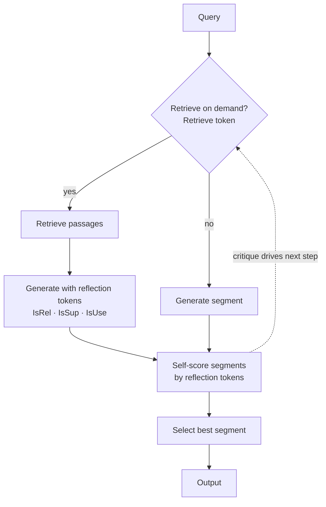
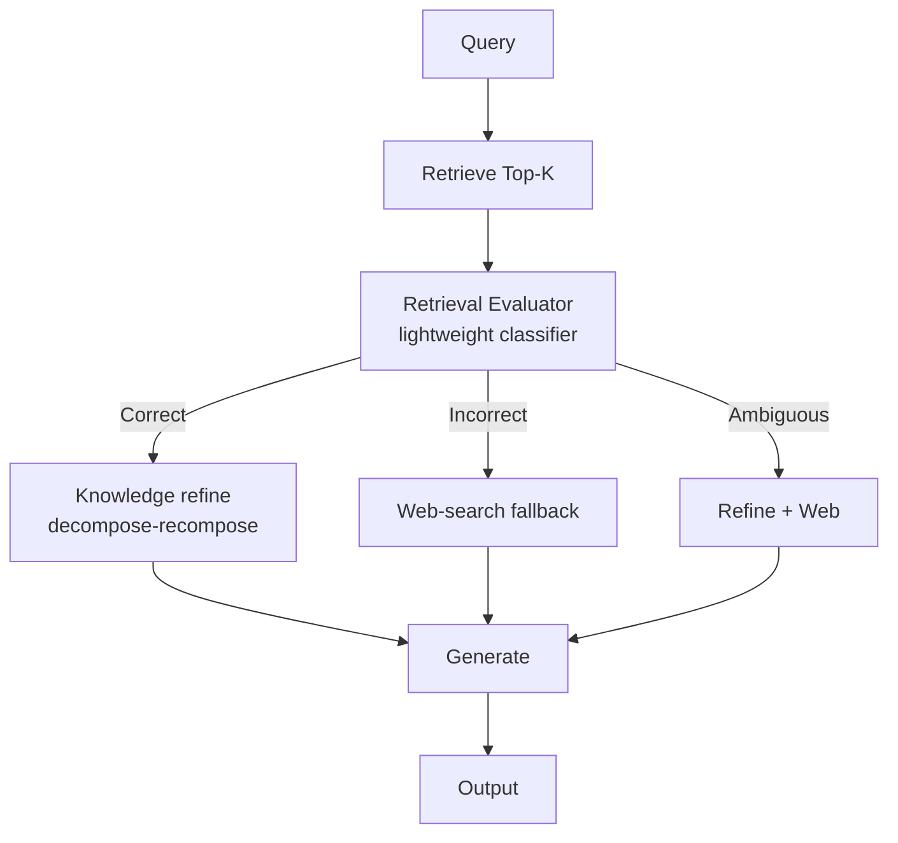
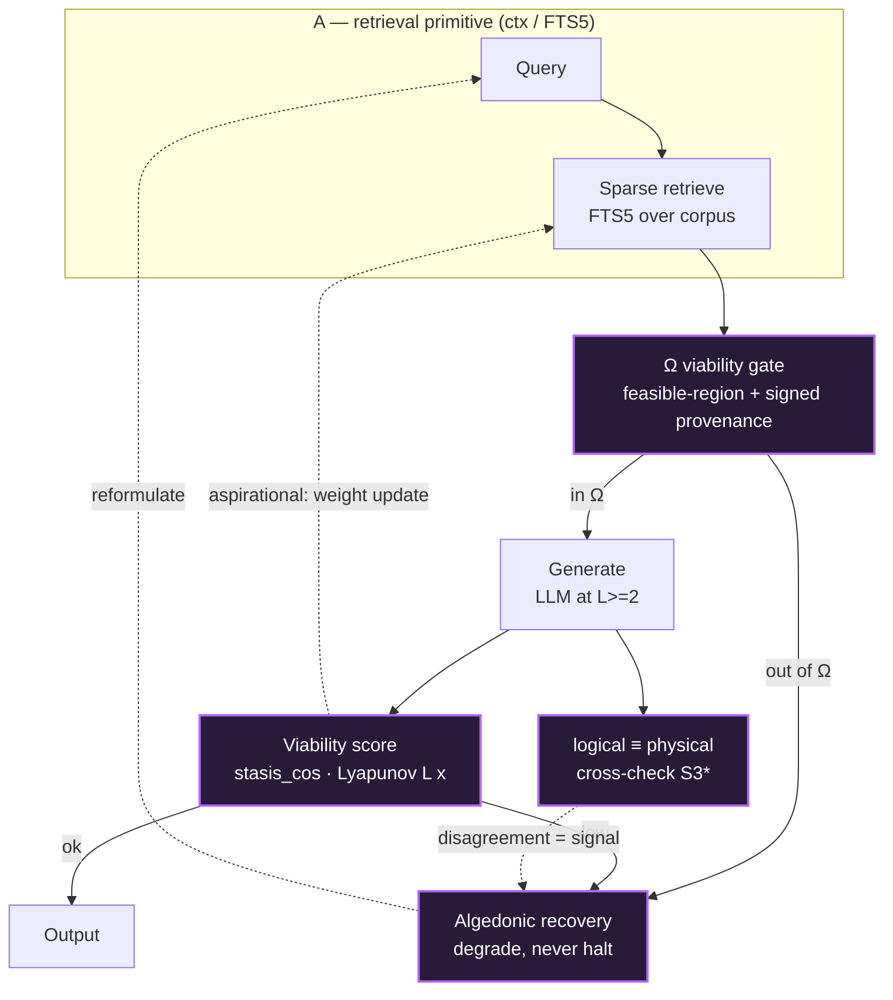

# Cybernetic RAG — retrofit mapping (VSF reality → RAG stages)
> **STATUS: historical_record** — consumido por fuse S4-ANTICIPATION → s4_anticipation.vsm · archivo 2026-08-15 (SPEC-REVISION-ORDER-PLAN censo; contenido en el target canonical, este doc es fuente histórica).

> **Status:** Phase 1 working analysis (`feat/cybernetic-rag`). This document GROUNDS the diagram;
> the Mermaid figure is its rendering, not the reverse. Model-agnostic (no S1–S5 layer names in the
> figure), but the *principles* are VSF's. Honest by construction: every mapping is labelled
> **faithful** (implemented + structurally equivalent), **partial** (implemented but weaker than the
> canonical stage), or **aspirational** (named in the design, not yet wired).

## 0. The framing (what we are and are NOT claiming)

VSF has **no document-RAG pipeline in code** (`grep` for RAG/embedding/vector/rerank/bm25 → empty).
So this is a **retrofit**: we describe a loop VSF *already runs* and ask whether it converges with, or
diverges from, the canonical RAG taxonomy. The subject is **A ⊂ B** (two recursion levels):

- **A — the retrieval primitive:** `context-mode` / `ctx` (FTS5 over `.index.db`; `ctx_search`,
  `ctx_index`, `ctx_batch_execute`). Genuine *sparse* retrieval over a document corpus.
- **B — the homeostatic wrapper:** the VSF **S4 intelligence loop** (qwen2.5-coder reads state/BBS →
  generates → a viability gate Ω filters → a measured viability signal evaluates → algedonic recovery
  feeds back). B wraps A.

**The load-bearing caveat (do not launder it):** B retrieves primarily over **system state**
(`state.db`, BBS) — *not* a document corpus. So the precise thesis is **structural**: *VSF's S4 loop is
a closed-loop, Ω-gated, homeostatic retrieval-augmented-generation cycle, and that structure — grounded
in a measured viability/Lyapunov signal — is what the canonical models lack.* It is NOT "we built a
better document RAG."

## 1. Component mapping

| RAG stage (Modular/Homeostatic) | VSF reality | Label | Note |
|---|---|---|---|
| Ingestion / chunk + index | **A:** `ctx_index` / FTS5 → `.index.db`; `docs_reconcile`. **B:** `state.db` populate; BBS writes | **partial** | FTS5 keyword index, **no dense embeddings**. Honest gap vs "Embedding Model". |
| Retrieval (dense+sparse hybrid) | **A:** `ctx_search` (FTS5 ≈ sparse/BM25). **B:** `vsf-q` queries over `state.db` | **partial** | Sparse only; no dense vectors, no hybrid fusion. |
| Re-ranking (cross-encoder) | — | **aspirational** | Not present. Qwen's diagram shows it; VSF does not implement it. |
| **Ω Context Validation Gate** | the **`Omega`** feasible-region check in the nucleus (`vsf-nucleus/src/omega_validator.rs`: `Omega::canonical()`, `omega.violations(state)`) + **AX-STATE-01** signed provenance | **partial** (mechanism faithful, RAG-wiring aspirational) | **NB:** `validator.py` is only the static `viability.yaml` linter, NOT this. The real Ω gates **state-vector transitions** (`operator.rs: deterministic_step_preserves_omega_membership`), not retrieved-context-before-generation. Mechanism real + validated; using it as a RAG context gate is the *proposal*. |
| Generation | **Ollama qwen2.5-coder:7b** @ S4 (L≥2 per D6) | **faithful** | Standard LLM generator. |
| Output guardrails | covenant/governance constraints; algedonic on violation | **partial** | Governance-level, not token-level hallucination/PII filters. |
| **Evaluator / Viability Score** | **`stasis_cos`** (state dim, `operator.rs`) + **`LyapunovTracker`** (`attractor.rs`: tracks L(x) per breath cycle, convergence) — *measured, live* | **faithful as substrate**, novel | Real measured dynamical signals (not an LLM-judge heuristic). HONEST NUANCE: they evaluate the **nucleus's own homeostasis** (the ℝ¹²⁸ state), not the quality of a generated answer. Contribution = *proposing this measured-viability substrate as the RAG evaluation signal*: substrate implemented, the RAG coupling aspirational. |
| **Recovery (low score)** | **algedonic channel** → recovery; **degrade-not-halt** (C5) | **faithful + novel** | Explicit homeostatic recovery vs canonical "say 'I don't know' / hallucinate". |
| Adaptive learning (score → retrieval weights) | trust tracking (trust=1.000); reconcile feedback to `state.db` | **aspirational** | Trust state exists, but the *closed* loop from evaluation back to retrieval/index weights is **not wired**. This is where the figure is a design, not a measurement. |
| Logical↔physical cross-check | **`topology_reconcile`** (S3*: model≡reality) | **faithful + novel** | Ax_AttestationSeparation: belief (attested state) vs observation (census); their disagreement is its own signal. No RAG analogue. |

## 2. Convergence analysis — against the FULL taxonomy (the honesty Qwen's table skipped)

Qwen compared only against **Naive / Advanced / Modular RAG** — and concluded "novel: closed-loop +
evaluation feedback". That comparison is **incomplete and would over-claim**. The closest priors are
the self-reflective / corrective family, which Qwen omitted:

- **Self-RAG** (Asai et al., 2023): the model emits *reflection tokens* to critique its own retrieval
  and generation → already a closed evaluation loop.
- **CRAG / Corrective RAG** (Yan et al., 2024): a lightweight evaluator scores retrieval quality and
  triggers corrective retrieval / web-search fallback → already "recovery on low score".
- **Agentic / Modular RAG**: explicit evaluator agents + routing + iterative retrieval.

**So VSF's loop CONVERGES with Self-RAG / CRAG / Agentic RAG on structure** (evaluation + corrective
feedback are *prior art*; we must not claim that as our novelty).

## 3. The isolated genuine contribution

What remains **original** after removing the prior art is narrow but real, and it is exactly the part
VSF actually implements:

1. **The evaluation signal is a measured dynamical-systems viability metric** (`stasis_cos`, Lyapunov
   dL, attractor convergence — validated, Fierro UV 2026-05-01), **not** an LLM self-critique token
   (Self-RAG) nor a learned retrieval-quality classifier (CRAG). The feedback is grounded in stability
   theory, with a formal **Ω feasible region**.
2. **The validation gate Ω is a viability/coherence boundary**, and (with AX-STATE-01) a *signed,
   tamper-evident* provenance check on the retrieved context — a security property no RAG model has.
3. **The framing is homeostatic/VSM-cybernetic** (Beer), not pipeline-agentic — which is what licenses
   recursion (A⊂B) and the logical↔physical cross-check.

Defensible one-liner: *"Self-RAG/CRAG add an LLM-judged correction loop; we add a **measured-viability**
homeostatic loop with a formal stability region and signed-provenance gating."*

## 4. Open gaps (what must be built to make the claim fully true, not just structural)

- **G1 (dense retrieval):** A is sparse-only. The thesis survives without embeddings, but a hybrid
  retriever would close the "partial" rows. *Optional for the argument; required for a real product.*
- **G2 (the adaptive learning link):** evaluation → retrieval/index-weight update is **aspirational**.
  Either wire it (then the homeostasis claim is measured, not designed) or the figure must mark it
  dashed/aspirational. **Do not draw it as solid.**
- **G3 (corpus vs state):** be explicit in the figure that retrieval is over system-state, with `ctx`
  (A) as the document-corpus sub-level.

## 5. Next step (gated)

This mapping is the contract for the figure. **IF** the mapping above is accepted **THEN** render the
Mermaid diagram with: faithful nodes solid, aspirational nodes (rerank, adaptive-learning link) dashed,
the Ω-gate + viability-score + algedonic-recovery + logical↔physical cross-check as the highlighted
differentiators, and an explicit A⊂B recursion boundary. Render in the wiki (`pymdownx.superfences`
already enabled) — no `mmdc`/Chromium, no draw.io. Deploy target for Phase 2: the existing opsroom
panel structure (internal, LXC 101), content re-conceptualised (task #6).

## 6. The three figures (model-agnostic)

> Rendered in-wiki via `pymdownx.superfences` (no `mmdc`/Chromium, no draw.io). Dashed = aspirational.

### 6.1 Self-RAG (Asai et al., 2023) — LLM-internal reflection loop

*Loop is internal to the LLM: it emits its own reflection tokens to decide retrieval and critique output.*

### 6.2 CRAG / Corrective RAG (Yan et al., 2024) — external evaluator + corrective retrieval

*An external evaluator scores retrieval quality in 3 tiers and triggers correction before generation.*

### 6.3 Cybernetic RAG (VSF retrofit, A⊂B) — measured-viability homeostatic loop

*Differentiators (purple): the Ω gate, the measured viability score, algedonic recovery, and the
logical≡physical cross-check. Dashed edges = aspirational (the adaptive weight-update link is design,
not yet wired — G2). Retrieval (A) is over a corpus; the wrapper (B) is over system state.*

---

## Verification (2026-06-04, this session)
- **Ω gate:** CONFIRMED real but **NOT** `validator.py` (that is only the `viability.yaml` linter). The
  runtime Ω is `vsf-nucleus/src/omega_validator.rs` (`Omega::canonical`, `violations()`), gating ℝ¹²⁸
  state-vector transitions (`operator.rs`). Re-labelled **partial**: mechanism faithful, RAG-context-gate
  wiring aspirational.
- **Viability signals:** CONFIRMED real + live — `stasis_cos` (`operator.rs` state dim), `LyapunovTracker`
  (`attractor.rs`, L(x) per breath cycle). They measure nucleus homeostasis, not generation quality →
  structural analogy, not literal RAG scoring. Net: the **measured-viability substrate is implemented**;
  its coupling to a retrieval+generation loop is the proposal.
