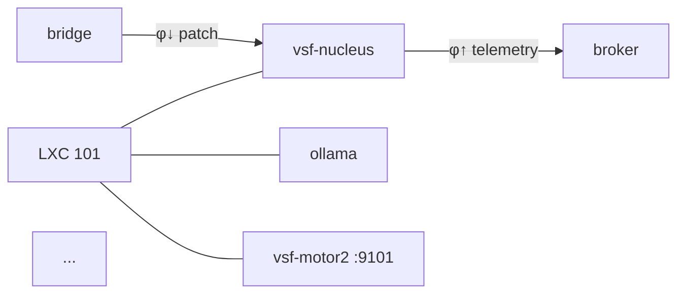

# D.4 — SCADA-style Opsroom Dashboard

> **⚠️ SUPERSEDED / DECOMMISSIONED (2026-06-06).** The SCADA dashboard was built,
> then decommissioned (cutover §7.4) and replaced by the **formaid diagram studio** +
> modular view-host on LXC 109 (`vsf-view-host.service`, `:8088`). This spec is kept
> for history and as the *reference shape* for guest-agent specs (see
> `docs/theory/systems/agents/opsroom/Guest_pattern.md`). Do NOT implement it — see
> `docs/spec/legacy_module_migration.md` + memory `project_opsroom_formaid` for current state.

**Status:** spec **v0.2** (2026-05-31, Qwen-reviewed). ~~Ready for agent.~~ DONE then superseded.
**Estimated effort:** ~3-4h agent session (refined from 3-6h post-Qwen
review which clarified scope).
**Bloqueador prerequisito:** ninguno; todas las fuentes de datos
existen (state.db, motor2 HTTP, events.jsonl, checkpoints.jsonl).

**v0.2 changelog:** Qwen acknowledgment 2026-05-31T11:45Z added
integration_catalog (§5), architectural refinements (§5b), security
gates (§5c), and refined 7-step execution sequence (§6).

---

## 1. Visión

Una sala de control estilo **SCADA** para VSF: cada componente del
sistema visible como un nodo con estado en tiempo real; cada canal
de comunicación (φ↑, φ↓, algedonic, NATS subjects, chain events)
visible como un flujo; el operador puede recibir Y enviar señales
algedónicas desde la misma interfaz.

**No es un dashboard de métricas estilo Grafana.** Es un **flow
diagram interactivo** donde la topología del sistema es el
escenario, y el estado de cada nodo + cada arista es el dato vivo.

## 2. Principios

1. **Auto-generado del canon, no manual.** El mapa se construye
   leyendo `state.db` (components/services/deploys/chain_state) +
   `motor2` HTTP + filesystem (checkpoints, alertas). Si el sistema
   cambia, el dashboard se actualiza solo en la siguiente recarga.
   Manual desincroniza en semanas.

2. **Bidireccional.** Recibir señales: cada nodo muestra su último
   estado, alertas pendientes, sha de su binario, último deploy.
   Enviar señales: botones para publicar algedonic en NATS, forzar
   refresh, restart de un service, kill -9 (con confirmación).

3. **Cero polling fuerte en cliente.** El backend (FastAPI proxy en
   `opsroom/api.py`) hace consultas, el cliente recibe `EventSource`
   (SSE) o polling muy ligero (~5s). Reduce carga.

4. **Renderable también en formato estático** para incluir en el
   paper (e.g., `eraser.io` flow diagram exportado como PNG/SVG).

## 3. Componentes a mapear (inicial, derivado de state.db hoy)

### LXCs (4 activos + 1 reservado)

| LXC | Rol | Componentes |
|-----|-----|-------------|
| 101 | Nucleus + LLM + Motor2 + Witness | vsf-nucleus-operational, ollama, vsf-motor2, vsf-checkpoint.timer |
| 104 | S5 plane + algedonic | vsf-bbs-bridge, vsf-g6-algedonic-sink, vsf-s5-algedonic, s5_console |
| 106 | Message bus | nats-server, bbs-api |
| 107 | Auditor | vsf-s3-star |
| 105 | (reservado BBH) | — |

### Servicios sistemizados (de `services` table)

Por cada uno, registrar: `lxc, name, active, pid, binary_sha,
active_since, refreshed_at`. Mostrar: verde si active=1 y sha matches
last deploy; amarillo si active=1 pero sha != last deploy;
rojo si active=0.

### Canales de datos/control

| Canal | Subject NATS | Dirección | Productor → Consumidor |
|-------|--------------|-----------|------------------------|
| φ↑ telemetry | `vsf.alpha.vsf_nucleus.up.*` | nucleus → broker → s3-star, bridge | events.jsonl line |
| φ↓ patches | `vsf.alpha.phi_down.params` | bridge → broker → nucleus | ConfigPatch apply |
| algedonic | `vsf.alpha.algedonic.*` | any → broker → g6-sink, s5_console | severity-weighted |
| s3-star audit | `vsf.alpha.s3_star.audit.*` | s3-star → broker → nucleus | findings |
| sha_divergence | `vsf.alpha.algedonic.sha_divergence` | populate.sh → broker → g6-sink | G-D.4 |
| BBH ideas | `bbh.>` | bbh-subscribers → broker → nucleus | future |

### Estado del kernel (chain + audits)

- chain head sha (nucleus + s3-star) — viene de `chain_state` table
- chain length (líneas en events.jsonl) — viene de `chain_state`
- chain format version (v1/v2 mix) — derivable inspeccionando últimos N
- checkpoint sidecar: count + last_minted_ts (filesystem)
- algedonic_counter actual (en memoria del nucleus; via motor2
  endpoint nuevo `/v1/algedonic_counter` si se necesita)

### Deploys recientes (de `deploys` table)

Lista de últimos 10: ts, component, lxc, to_sha, result. Permite ver
en un click "qué binario está corriendo dónde, desde cuándo".

### Alertas activas

`grep -c` sobre `/alerts/operator_inbox.log` (en LXC 104) por
categoría. Click en categoría → ver últimos N entries.

## 4. Interacciones (envío de señales)

### Tier-α (botones simples, confirmar antes de actuar)

- **Refresh chain_state**: ejecuta `systemctl start vsf-state-populate.service` en n02
- **Verify witness corpus**: ejecuta `/usr/local/bin/vsf-checkpoint-verify` y muestra resultado
- **Trigger recovery gate**: dropdown G2/G3/G4/G5 + ejecutar
- **Emit operator algedonic**: form (category, severity, detail) → publish a `vsf.alpha.algedonic.operator`
- **View component log**: `pct exec <lxc> -- journalctl -u <service> --since "5 min ago"` (tail in modal)

### Tier-β (deferido, requiere auth)

- Restart service, stop service
- Inspect `bbs.db` via Motor 2 endpoints
- Replay last N events (read-only)

## 5. Arquitectura técnica

**Backend** (`opsroom/api.py` extendido — FastAPI ya existe):

```
GET  /api/topology           → JSON: lxcs + components + edges (canales)
GET  /api/services           → JSON: services snapshot from state.db
GET  /api/chain_state        → JSON: heads + lengths
GET  /api/checkpoints        → JSON: {total, last_minted, valid_pct}
GET  /api/alerts/recent?n=N  → JSON: last N alert lines
POST /api/actions/refresh    → triggers populate.sh
POST /api/actions/algedonic  → publishes to NATS
GET  /api/sse                → SSE stream of "anything changed" events
```

Las consultas backend usan:
- Motor 2 `http://n02-tunnel:9101/v1/*` (ya existente)
- SSH + sqlite3 contra `state.db`
- SSH + `pct exec` para acciones

**Frontend** (`opsroom/scada.html` nuevo):

- Pure HTML + vanilla JS + SVG para el grafo (sin React/framework
  pesado — coherente con la estética minimal del proyecto)
- Cada LXC = bounding box; cada componente = circle con color
- Aristas = curvas SVG con labels (subject NATS)
- Sidebar derecho: detalle del nodo seleccionado + acciones
- Topbar: score actual (estructural + funcional), última alerta
- Refresh via SSE; fallback a polling 5s

**Diagrama estático** (`opsroom/scada.mermaid`):



Auto-generado por un script `opsroom/gen_mermaid.py` que lee
state.db. Compatible con eraser.io paste.

## 5b. Refinements (Qwen review 2026-05-31)

### R1. Single source of truth principle

`state.db` is canonical; filesystem (checkpoints, alerts) is secondary.
**Add a hook to `vsf-state-populate`** that syncs filesystem metadata
INTO state.db: `services.last_action_ts`, alert counts per category,
checkpoint corpus size + valid_pct. Frontend then queries ONLY state.db
— preserves the canon-ordering rule.

### R2. Algedonic POST must validate

`POST /api/actions/algedonic` should reject if the supplied category
is not in `s5_policy.algedonic.allowed_categories[]`. Return 403 with
the allowed list. Prevents operator-error storms.

### R3. Delta-compression + ?since= for polling fallback

SSE should send only fields that changed since last frame. If client
polls (SSE unavailable), endpoints accept `?since=<unix>` and return
only diffs. Motor 2 endpoints additionally must accept `?since=` for
the frontend's consistent fetch model.

### R4. Snapshot-able mermaid

`gen_mermaid.py` accepts `?snapshot_ts=<unix>` to fetch historical
state from the audits table (which carries timestamps). Reproducible
diagrams for the paper.

## 5c. Action security gates (Tier-α)

| Action | Auth | Notes |
|--------|------|-------|
| refresh_chain_state | none | idempotent, low-risk |
| verify_witness | none | read-only |
| trigger_recovery_gate | confirmation modal + log entry to inbox | disruptive |
| emit_operator_algedonic | severity ≤ 7 only; critical needs S5 override | spam prevention |
| view_component_log | none, but truncate to last 50 lines + redact secrets | privacy |

Deferred to Tier-β (require API key + audit log):
- restart/stop services
- inspect bbs.db (use Motor 2 with token + query whitelist)
- replay events (time-range + rate limit)

## 5d. State.db schema extensions (already-partial)

Already present (cycle 3):
```sql
ALTER TABLE components ADD COLUMN llm_consumer INTEGER DEFAULT 0;
```

Agent must add:
```sql
ALTER TABLE services ADD COLUMN last_action_ts TEXT;
CREATE TABLE IF NOT EXISTS opsroom_sessions (
    session_id     TEXT PRIMARY KEY,
    user_id        TEXT,
    started_at     TEXT NOT NULL,
    last_heartbeat TEXT
);
```

## 5e. Motor 2 endpoints to extend

Add to `projects/vsf-motor2/src/main.rs`:
- `GET /v1/algedonic_counter` — last algedonic_seq from chain head
- `GET /v1/services/health` — JOIN services × audits, return aggregate
- (Tier-β only, deferred) `POST /v1/actions/kill` — graceful shutdown signal

## 6. Cómo arrancar (orden de trabajo del agente)

**Qwen-refined 7-step plan (~3-4h):**

1. **Read canon** (~30 min): state.db (rules/components/services/
   chain_state/lxcs/deploys/specs/audits), CLAUDE.md, RULES.md,
   HANDOFF.vsm.md (cycles 2+3 blocks), opsroom/api.py existing.

2. **Extend Motor 2** (~30 min): add `/v1/algedonic_counter` and
   `/v1/services/health` endpoints per §5e. Rebuild + redeploy
   to LXC 101 via deploy_bundle pattern.

3. **Extend opsroom/api.py** (~1h): implement endpoints from §5
   integration_catalog. Apply R1 (state.db single source —
   hook populate.sh to sync filesystem metadata into state.db)
   + R2 (validate algedonic POST against s5_policy) + R3
   (?since= delta-compression).

4. **Scaffold frontend** (~1.5h): scada.html + static/scada.{js,css}.
   SVG graph with green/yellow/red node states per §5c traffic-light
   convention. Sidebar (node detail + actions) + topbar (score + last
   alert). SSE connector with delta-compression; polling fallback.

5. **gen_mermaid.py** (~30 min): emit eraser.io-compatible mermaid
   from current state.db. Accept `?snapshot_ts=<unix>` per R4 for
   reproducible paper figures.

6. **State.db sync hook** (~20 min): populate.sh extended to sync
   `/alerts/operator_inbox.log` line counts + checkpoint corpus stats
   into new columns/tables (R1). Idempotent.

7. **Documentation** (~30 min): opsroom/README.md (how to run);
   Annex B §7.3 closes G-OPS.1; TASKS.md updated.

## 7. Salidas esperadas

- `opsroom/api.py` extendido (~200 LOC nuevas)
- `opsroom/scada.html` (~400 LOC)
- `opsroom/static/scada.js` + `scada.css` (~300 LOC combinado)
- `opsroom/gen_mermaid.py` (~80 LOC)
- `opsroom/README.md` con instrucciones
- Comentario en `docs/papers/attractor_convergence/annex_B...md`
  §7.3 nueva entrada G-OPS.1 closed

## 8. Out of scope (deferido para otra sesión)

- Auth / multi-user
- Histórico (Grafana-style time-series)
- Edición de viability.yaml desde la UI
- Mobile responsive
- Integración con `simplify` continuo o auditor automático
  (eso es D.5+ separately)

## 9. Cómo invocar al agente

```
Agent({
  description: "SCADA opsroom dashboard impl",
  subagent_type: "general-purpose",
  prompt: <contenido de este spec + brief de 100 palabras al inicio>,
  isolation: "worktree"  // recomendado, son ~1000 LOC
})
```

El agente debe terminar con: rama nueva lista para merge, captura
del dashboard funcionando (vía screenshot del Playwright o similar),
y un comentario en `TASKS.md` moviendo G-OPS.1 a "closed".
