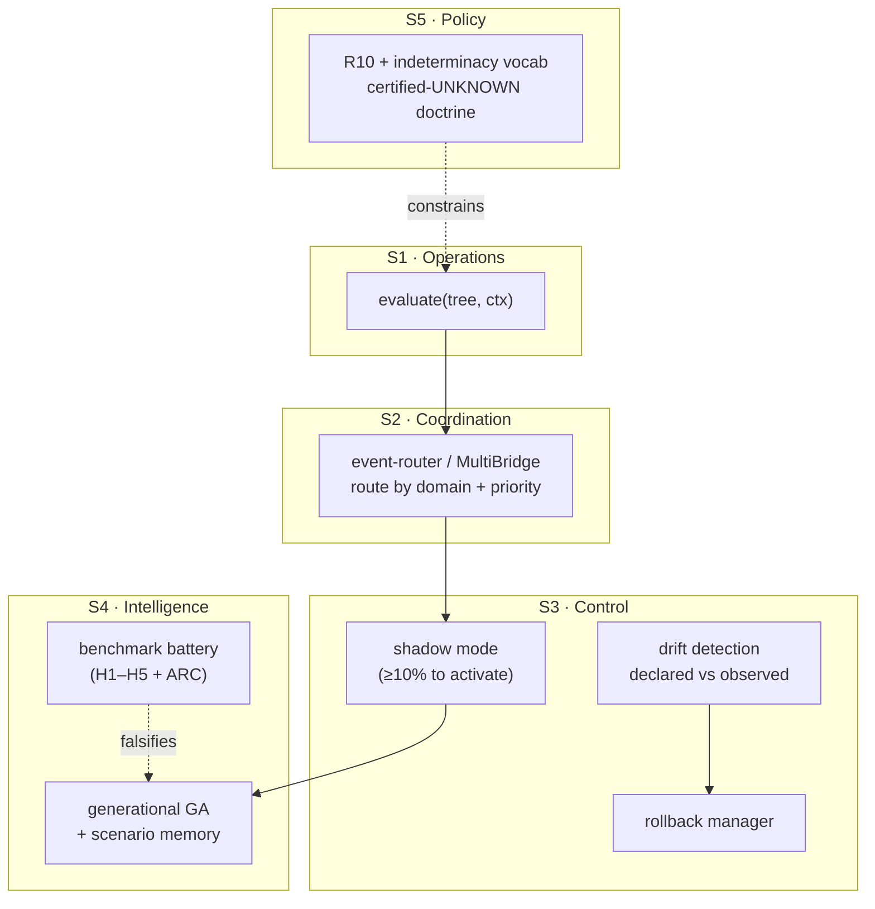
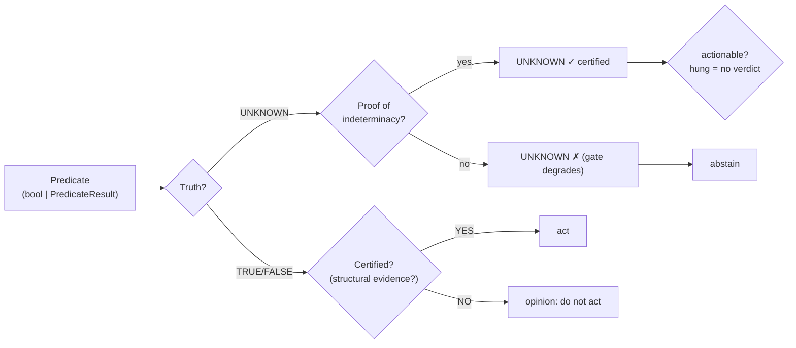

# Certified UNKNOWN: Proof-Carrying Abstention for Governed Autonomy

> NOT valid VSL — arXiv working draft (Markdown, destined for LaTeX).
> Exempt from .vsm policy by destination format (cf. docs/archive/*.md
> precedent). Content is normative for the publishing track.

**Working draft** — vOSlabai / rmw3 — 2026-09-23 — status: outline + measurementsbrief, sections in progress.

> Target: arXiv cs.AI (systems paper with code + measurements, NOT a
> survey). Requires endorsement (path 2: personal, domain authors).
> Related: arXiv:2603.16586 (deterministic policies), arXiv:2604.19818
> (proof-of-guardrail), arXiv:2606.02965 (informed abstention).

## Abstract (draft)

Agentic benchmarks saturate on task success while ignoring whether the
agent should have acted at all — and whether anyone can verify that its
guardrails ran. We present a control plane for governed autonomy built
on a single separation: *truth* (trivalent: TRUE/FALSE/UNKNOWN) from
*certification* (evidence-backed or not). Uncertainty propagates as
UNKNOWN rather than collapsing into a default branch; when the
indeterminacy itself is proven, the UNKNOWN is certified with the proof
attached, under a fixed vocabulary enforced by a runtime gate. A jury
operator certifies disagreement itself through tallied, quorum-bound
verdicts. Strategies improve through a generational loop validated in
shadow mode before production, with full cross-cycle retention. Every
efficiency claim is measured per operation against a standing bound.
On a six-suite replayable battery: precision@certified 1.0 with zero
false certifications; evolutionary slopes ≥ 0 with holdout
generalization and 3/3 ablation wins over equal-budget random search;
governance overhead p95 229ms with 130B/action audit volume;
deterministic evaluation across hash seeds; graceful degradation over
16 chaos scenarios with zero escaped exceptions. Head-to-head, the
system abstains correctly where LangGraph defaults decide confidently
(3/3 vs 0/3) and matches NeMo Guardrails' deterministic rails while
adding what they lack: a truth value, certification vocabulary, and
propagation algebra for uncertainty. All artifacts, seeds, and replay
hashes are published, including the development phases where the
battery failed.

## 1. Introduction

Agentic benchmarks are saturating on task success: SWE-bench Verified
approaches 95%, τ²-bench 99%. These numbers measure the underlying
model, not the architecture around it — and they systematically ignore
the question that determines whether an autonomous system is
deployable: *should it have acted at all?* A coding agent that resolves
95% of issues but confidently executes the remaining 5% wrong is not
95% viable. Recent work converges on this gap from three directions:
policies-as-deterministic-functions for runtime governance, proof that
guardrails actually executed (not merely existed), and protocols for
informed abstention that distinguish a principled pause from a silent
failure. All three point at the same missing object: a control plane
that decides *whether* to act, with evidence, at measured cost.

This paper presents such a control plane, built and measured rather
than proposed. Its thesis is a separation: *truth* (trivalent:
TRUE/FALSE/UNKNOWN) from *certification* (evidence-backed or not). A
large model may opine TRUE uncertified; only deterministic predicates
over inspected state certify. Uncertainty is not collapsed into a
default branch — it propagates as UNKNOWN, and when the indeterminacy
itself is proven (undecidability reduction, hung jury with quorum,
exhaustive search, verified vagueness), the UNKNOWN is certified with
the proof attached. Strategies improve through a generational loop
validated in shadow mode before touching production, with full
retention across cycles. And every claim about cost is measured per
operation against a standing bound, with honest failures published
alongside the passes.

Our contributions: (1) a trivalent evaluation engine with a
certification algebra over seven operators, including a jury operator
that certifies disagreement itself; (2) an indeterminacy vocabulary
with a runtime validation gate; (3) an evolutionary loop with
shadow-gated activation and cross-cycle retention; (4) a six-suite
replayable battery plus two external head-to-heads, all green except
where honestly red — with the red phases profiled, fixed, and
recorded. All artifacts, seeds, and replay hashes are published.

## 2. Related work

*Deterministic runtime policies.* Recent work formalizes agent
governance as deterministic functions over agent identity, partial
execution path, proposed action, and organizational state — arguing
that nondeterministic policy evaluation makes audit logs unverifiable
and compliance guarantees unstatable (2603.16586). We arrive at the
same constraint independently (our R10: predicates must be pure
functions of their inputs, verified by hash-seed invariance testing),
and extend it from policy functions to the full evaluation algebra,
including an explicit account of what happens when evaluation cannot
conclude.

*Proof-of-guardrail and trace assurance.* A second line argues the
central object of control is the execution path, demanding trace
contracts, deterministic replay, structured fault injection, and
governance outcome distributions — plus evidence that the guardrail
*ran*, not merely that it exists (2604.19818). Our JSONL audit trail,
negative controls, H4 chaos battery (kill/flap/recover with zero
escaped exceptions), and pinned replay hashes are a running instance
of exactly this program, with per-operation cost accounting added.

*Informed abstention.* A third line specifies what it takes to abstain
well: protocols distinguishing principled pause from silent failure
and blanket refusal, calibrated guards, runtime enforcement, and
auditable traces of every pause — evaluated across 144 scenarios and
seven model families (2606.02965). Our H1 battery is that protocol
operationalized with falsifiable thresholds (precision@certified =
1.0, zero false certifications), and our indeterminacy vocabulary
gives the pause a machine-checkable form the framework calls for but
does not specify.

*Programmable guardrails.* NVIDIA NeMo Guardrails offers Colang flows
across five rail types with execution rails for tool validation — the
closest existing system, and the one we benchmark against head-to-head
(§4). Its runtime is LLM-centric (dialog progression requires model
calls), and uncertainty has no truth value, no certification
vocabulary, and no propagation semantics in its design. Our
contribution relative to it is precisely this layer: what happens,
structurally, between "evidence insufficient" and "act anyway."

*Governance framing.* Kasirzadeh & Gabriel (Nature 2026) profile agents
along autonomy, efficacy, goal complexity, and generality, calling for
safeguards proportional to the profile (cf. WEF/IMDA progressive
governance). Our system targets the high-autonomy/high-efficacy corner
and answers with proportional machinery: shadow validation before
activation, automatic rollback, calibrated abstention, and cost bounds.

## 3. Architecture

### 3.1 Trivalent evaluation with certification algebra

Every evaluation returns `(truth, certified, evidence)` where truth ∈
{TRUE, FALSE, UNKNOWN} and `certified` records whether the verdict is
backed by structural evidence — never by model opinion. A large language
model may return `TRUE` with `certified=False` (it opines); only
deterministic predicates over inspected state return `certified=True`.
This is the R10 boundary: the engine cannot tell *what* a predicate
means, only whether its claim is evidenced.

Operators compose trivalence with per-operator certification rules.
`AND` requires all relevant children certified; `OR` requires one
certified TRUE child; `NOT`/`XOR`/`IMPLIES` require all children. Two
operators handle the non-classical cases. `DIALECTICAL_AND` treats
certified TRUE+FALSE conflict as productive indeterminacy (UNKNOWN,
certified, with thesis/antithesis in metadata) rather than rejection —
the contradiction itself is a fact. `JURY` (§3.3) tallies votes.
`computation` nodes evaluate feature chains (`d0 → d1 → d2` over a
15-operation algebra) natively before branching, so evolved genomes are
evaluated with zero translation loss.

UNKNOWN propagates through all operators (never silently collapses to
TRUE/FALSE), and uncertified inputs poison certification downstream.
Empty `AND`/`OR` yield logical identities with warnings; empty `NOT`
is a structural error. All of this is pinned by 546 package tests,
including adversarial suites for each operator.

### 3.2 Indeterminacy vocabulary and validation gate (R10-corolario)

Certification admits UNKNOWN, but only with *proof of indeterminacy*:
the evidence must carry an `indeterminacy` block whose `kind` belongs
to a fixed vocabulary — `undecidable-reduction` (halting/Gödel-style
impossibility proofs), `quantum-superposition` (no definite value
pre-measurement, with `collapses_on`), `jury-hung` (quorum met, no
supermajority, with tally), `exhaustive-empty` (complete search, no
finding), `vague-boundary` (verified sorites penumbra), `symmetric-tie`
(with `tiebreak_procedure`). A runtime gate degrades any
UNKNOWN+certified lacking a valid block to uncertified with a warning;
truth is preserved, the caller's object unmutated.

The design distinction: *verified absence* (exhaustive search over a
bounded domain, empty result) is expressed as TRUE-with-evidence, not
as UNKNOWN. UNKNOWN is reserved for genuine indeterminacy or honest
ignorance — and the two are told apart by the presence of the proof
block. This answers the open question in prior work of how to
distinguish "a principled pause from both a silent failure and a
blanket refusal": structurally, in the evidence schema, checkable
without reading transcripts.

### 3.3 Jury operators: certifying disagreement

`{"op": "JURY", "children": [...], "quorum": n, "supermajority": s}`
evaluates all children (no short-circuit — every vote is evidence) and
tallies. A side reaching `supermajority` (default ⅔, must lie in
(0.5, 1.0]) wins determinately. Otherwise, with quorum met, the verdict
is hung: UNKNOWN, certified, with the full tally plus an
`indeterminacy: jury-hung` block in metadata. Without quorum there is
no verdict (UNKNOWN, uncertified — incomplete tally is ignorance, not
indeterminacy). Certification requires all votes certified: a single
unaudited vote voids the procedural guarantee, including abstentions
(UNKNOWN votes neither side, but uncertified abstentions poison the
tally — they must carry their own indeterminacy proof to stay
certified). This mirrors institutional precedent (Scots *not proven*:
the jury certifies insufficiency of evidence through proper procedure)
and gives multi-agent disagreement a first-class, auditable form.

### 3.4 Evolutionary strategy search under shadow validation

Faults (≥3 BLOCKING observations in a sliding window, persisted across
subprocesses) trigger a generational genetic loop: up to 3 generations
× 5 genome candidates; gen-0 random, later generations bred from
shadow-ranked winners via genome-level crossover/mutation with elitism,
early exit on first passing generation. Candidates are validated in
shadow mode against baseline (≥10% improvement to activate) with
automatic rollback on degradation. Winners persist to scenario memory
*with their full decision tree* and reseed subsequent cycles
(cross-cycle retention); every candidate's tree is recoverable from a
strategy registry for audit. Test cases derive from real fault sample
events (not synthetic), and UNKNOWN evaluations are excluded from
accuracy accounting (they are non-answers, not errors).

### 3.5 Cost accounting as a design constraint

Every evaluation pays audit persistence (event log, observer journal,
tree traces, attestations, fault windows). Measured per-operation
latencies feed a standing bound (p95 < 500ms per tool call, <4KB audit
volume per action); breaches fail the battery. Optimizations preserve
semantics: record-only fast paths off the hot path, bounded tail reads,
compact serialization, deterministic sampling (failures always traced,
successes 1-in-20 by counter — never random, preserving determinism).
The battery's red phases are published, not hidden: two honest failures
during development (a 5s per-call pipeline, an observer-effect bug
where introspection healed providers) were profiled, fixed, and
recorded with their numbers.
- 3.5 Cost accounting (per-eval audit persistence design, sampling).

## 4. Measurements (baseline_v2, replay 89616a69f91f74aa)

All suites run locally (no network, no model APIs) via
`python3 benchmarks/run_all.py` (seed 20260922). Each states its claim
and falsifiable threshold up front; exit code is nonzero on any FAIL.
Environment (repo SHAs, Python version, env vars) and a replay hash
over all results are recorded in `benchmarks/results/baseline_v2.json`.

### H5 — Determinism (R10)
*Method.* 30 trees × 5 contexts (predicates, AND/OR/NOT/JURY,
computation nodes, missing-field UNKNOWN paths) evaluated in 3
subprocesses with `PYTHONHASHSEED=0/1/42`; semantic equality of
(truth, certified, normalized evidence) required everywhere, plus a
static scan for nondeterminism markers in the engine core (GA
randomness is the variation source and out of scope — R10 constrains
predicates, not evolution).
*Result.* 270 evaluations, 0 divergences, 0 markers. PASS.

### H1 — Certified honesty
*Method.* 16 hand-built adversarial cases in 4 classes: decidable (D),
ignorance — missing field/domain (I), certified conflict (C),
genuine indeterminacy (G). Two local ablation baselines: B0
(always-answer: coerce UNKNOWN→FALSE) and B1 (no-gate: endorse every
output, LLM-judge style). Deployment semantics: act only on certified
determinate outputs; every baseline action on unknowable ground truth
counts as unfounded.
*Result.* precision@certified = 1.0, false-certification rate 0.0, 7
actions 0 errors; B0/B1 take 9 unfounded actions where the system
abstains (abstention rate 0.56). PASS.

### H2 — Evolution
*Method.* 3 fault types × 5 cycles; per-cycle activated accuracy forms
a trajectory (least-squares slope must be ≥ 0, final ≥ baseline);
70/30 train/holdout split by input rank (holdout must stay within
0.10 of baseline — no regression); ablation of 15 fresh random genomes
(equal to the GA's max 3×5 budget) must not beat the GA in ≥2/3 faults.
Scenario store isolated per run; production untouched.
*Result.* Slopes +0.10/+0.02/+0.07, holdout 1.0 vs 0.8 baseline,
ablation 3/3. PASS.

### H3 — Governance cost
*Method.* 50 timed reps of the four hot-path operations (pre_check,
evaluate_action, record_pattern, match_patterns) plus a no-op floor;
log bytes per action. Bound: worst p95 < 500ms, <4KB/action.
*Result.* Worst p95 229ms (pre 190, eval 229, record 97, match 12),
130B/action. PASS — after two honest failures (5.07s record path,
L3-avalanche contamination) profiled and fixed; see §5.

### H4 — Chaos
*Method.* Scripted providers (kill, flap, recover, unknown domain,
priority duplicate) against MultiBridge; every failure must surface
as UNKNOWN + routing evidence + accurate health, zero escaped
exceptions.
*Result.* 16/16, 0 escaped. PASS — including the observer-effect fix
it forced (introspection no longer heals providers).

### ARC lane
*Method.* 12/120 ARC-AGI-2 eval tasks, format-validated; zero baseline
(predict input) as the floor every future solver must beat.
*Result.* 12/12 valid, floor 0.0%. Harness PASS; no solver claimed.

### External head-to-heads (report-only)
*vs LangGraph defaults* (7 honesty scenarios, pure-function nodes):
ours 3/3 correct abstentions, 0 confident errors, 0 crashes;
LangGraph 0/3, 2 errors (deny-on-missing, allow-on-conflict), 1 crash
— at policy-LOC parity (~23 vs ~21). The difference is default
semantics, not code volume. (`results/compare_lg_v1.json`)
*vs NeMo Guardrails deterministic layer* (input rails + pure-python
custom actions, tri-state judge, bot-message termination, no LLM):
5/5 rail verdicts correct, 0 crashes. Deltas: NeMo `unclear` is a
dialog act, not a truth value — no certification vocabulary, no
evidence flags, no propagation algebra; flows not terminating in bot
messages require an LLM backend (nondeterministic core by design).
(`results/compare_nemo_v1.json`)
| vs LangGraph | 3/3 vs 0/3 abstain, LOC parity |
| vs NeMo rails | 5/5 rail verdicts; deltas documented |

## 5. Discussion

The battery's value proved to be diagnostic, not ceremonial. Three
episodes illustrate what falsifiable governance measurement buys that
unit tests alone do not.

*The 5-second tool call.* The cost battery's first run failed with a
95th percentile of 5.07s on the record path: every tool call ran the
full RSI pipeline including predicate synthesis. No unit test caught
this because each component was "correct" — the pathology was
architectural (learning phases on the hot path). The fix (record-only
fast path, learning moved to the idle cadence) was a 77× improvement
found by measurement, not review.

*The vanishing gold.* The evolution battery's first runs showed
spike-then-lose trajectories: a 0.889 strategy found in one cycle,
gone the next. Winners were recorded to scenario memory but re-seeded
only as default trees — the learned content was discarded at the
retention boundary. The benchmark forced a retention mechanism (full
winning trees reloaded across cycles); trajectories stabilized upward.

*The healing patient.* The chaos battery caught an observer effect:
health introspection called the tracking wrapper, so asking about a
dead provider's health recorded a success and cleared its failure
count. The monitor healed the patient by observing it. The fix
(untracked introspection reads) is a three-line change with a
regression test — but only a fault-injection battery could have found
it, because the bug lived in the interaction between two correct
components.

Limits. We report no external LLM-judge baseline (no API budget; our
baselines are ablations, which test the architecture against itself
rather than against the field). No hardened adversary yet: NeMo's
full stack needs an LLM backend we did not provision. The ARC lane
stands at a published 0.0% — a floor, not a result. Each limit is a
named future experiment, not a caveat in small print.

## 6. Future work

- ARC program-synthesis solver over grid DSL (harness ready).
- Round-2 comparison vs hardened stacks.
- Codabench publication of H1–H5 as runnable benchmark.
- Async audit persistence (durability-preserving design).

## 7. Conclusion

Governance architectures should be measured the way they claim to
work: on whether certified outputs are ever wrong, on whether
uncertainty abstains or guesses, on whether the system improves over
time, on what the machinery costs per decision, and on how it behaves
under injected faults. We built the battery that asks these questions
with falsifiable thresholds, ran it against our own control plane, and
published everything including the phases where it failed. The results
— precision@certified 1.0 across adversarial cases, compounding
evolutionary improvement with holdout generalization, sub-500ms
governance overhead with byte-level audit accounting, graceful chaos
degradation, and a located (not hand-waved) difference against two
external frameworks — suggest that separating truth from certification
and making abstention proof-carrying is not philosophy but engineering:
it compiles, it runs, it measures, and when it breaks, the measurement
says exactly where. The open problems are named, the harness is
public, and the next experiment is already specified. That is the
whole claim.

## Reproducibility

- Repos: socratic-engine v0.2.12, vsf-rsi v0.2.16 (tags, PyPI).
- Battery: `python3 benchmarks/run_all.py` (seed 20260922).
- Results: `benchmarks/results/baseline_v2.json`,
  `compare_lg_v1.json`, `compare_nemo_v1.json` (replay hashes inside).
- Figures: `docs/papers/certified-unknown/figures/make_figures.py`
  regenerates all PNGs from committed results (no hand-tuned numbers).

## Appendix A. Formal semantics

Three values ordered F < U < T (Kleene K3). Conjunction = min,
disjunction = max, negation fixes U:

| AND | T | U | F |
|---|---|---|---|
| **T** | T | U | F |
| **U** | U | U | F |
| **F** | F | F | F |

| OR | T | U | F |
|---|---|---|---|
| **T** | T | T | T |
| **U** | T | U | U |
| **F** | T | U | F |

NOT: T↔F, U→U. XOR: U if any input U, else parity. IMPLIES(a,b):
T if a=F; b if a=T; (T if b=T else U) if a=U. DIALECTICAL_AND:
U if any U; T iff all T; F iff all F; mixed T+F → U (conflict).

**Jury verdict function.** Given n votes with tallies (t, f, u),
quorum q (default n), supermajority s ∈ (0.5, 1.0] (default ⅔):
quorum fails (n < q) → UNKNOWN (uncertified, verdict `no-quorum`);
t/n ≥ s → TRUE; f/n ≥ s → FALSE; else UNKNOWN certified with
hung tally (UNKNOWN votes abstain — counted in n, credited to
neither side).

**Certification rules** (c = certified): AND: ∧c over evaluated
children (short-circuited unevaluated children excluded); OR: ∃
certified TRUE child; NOT/XOR/IMPLIES/DIALECTICAL: ∧c over all
children; JURY: ∧c over all votes ∧ quorum met. Predicate gate:
`truth=UNKNOWN ∧ c ∧ ¬valid-indeterminacy(evidence) ⟹ c := False`
+ warning (truth preserved).

**Indeterminacy type.** `indeterminacy = {kind ∈ K, proof}` where K =
{undecidable-reduction, quantum-superposition (+collapses_on),
jury-hung (+tally, quorum), exhaustive-empty (+scanned),
vague-boundary (+bounds), symmetric-tie (+tiebreak_procedure)}.
Any certified UNKNOWN must carry one; the gate enforces it.

## Appendix B. Architecture diagrams

## Appendix C. Result tables

**Operator semantics** (truth / certification):

| Operator | Truth | Certified iff |
|---|---|---|
| AND | min | all evaluated children certified |
| OR | max | ∃ certified TRUE child |
| NOT / XOR / IMPLIES | classical + U-propagation | all children certified |
| DIALECTICAL_AND | conflict → UNKNOWN | all children certified |
| JURY | supermajority else hung | all votes certified + quorum |

**Baseline v2** (replay 89616a69f91f74aa): H5 270/0 divergences;
H1 precision@certified 1.0, false-cert 0.0, 7 actions 0 errors vs
baselines 9 unfounded; H2 slopes +0.10/+0.02/+0.07, holdout 1.0,
ablation 3/3; H3 worst p95 229ms, 130B/action; H4 16/16, 0 escaped;
ARC 12/12 valid, floor 0.0.

**Head-to-head abstention scenarios**: ours 3 correct / 0 errors /
0 crashes; LangGraph defaults 0 / 2 / 1; NeMo rails 2 dialog-`unclear`
(no truth value) / 0 / 0 — at policy-LOC parity (~23 vs ~21).
